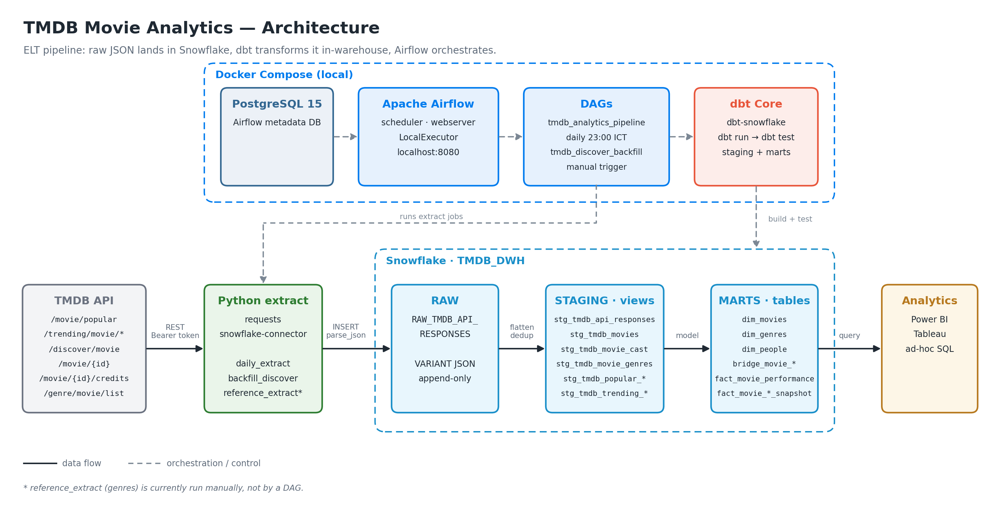
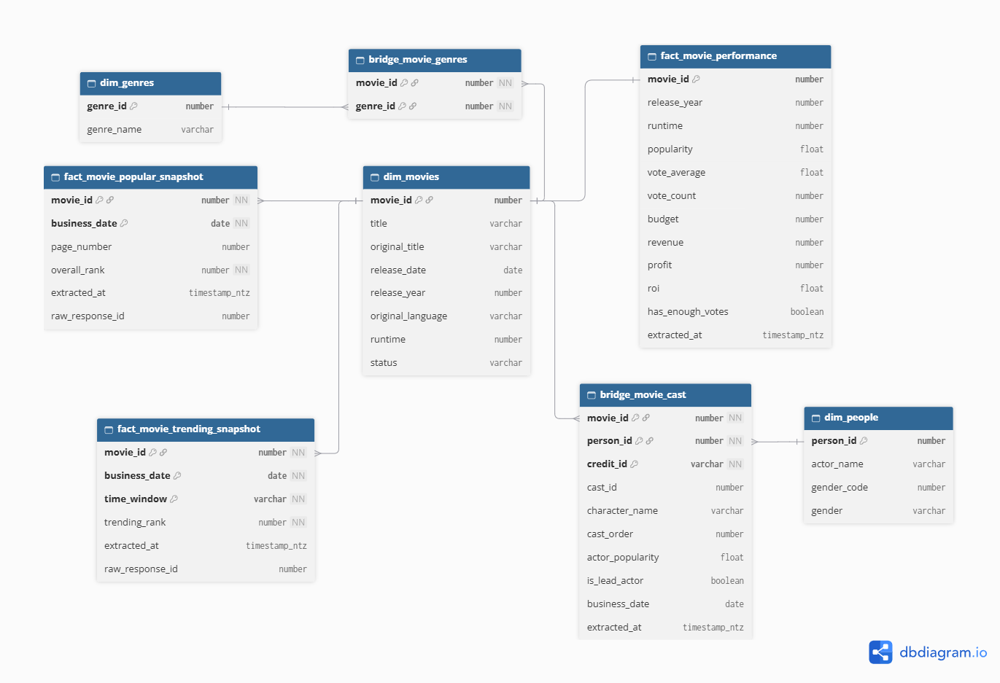

<div align="center">

# 🎬 TMDB Movie Analytics Data Warehouse

[Overview](#overview) •
[Architecture](#architecture) •
[Pipeline](#pipeline) •
[Data Model](#data-model) •
[Quick Start](#quick-start) •
[Roadmap](#limitations--roadmap)

</div>

---

## Overview

Python jobs extract movie data from the [TMDB API](https://developer.themoviedb.org/docs) and land every response as raw JSON in Snowflake. dbt then transforms the JSON, inside the warehouse, into an analytics-ready dimensional model. Airflow runs the whole pipeline every day in a local Docker Compose environment.

**Questions the warehouse answers**

- Which movies are currently popular or trending?
- Which genres have the highest revenue, rating and ROI?
- Are highly rated movies also high-revenue movies?
- Which actors appear most often in popular or high-performing movies?
- How different are trending movies from popular movies?

**Highlights**

- **ELT with a raw JSON layer.** API payloads are stored as Snowflake `VARIANT`, so every model can be rebuilt from raw at any time.
- **Idempotent reloads.** Raw is append-only, and dbt deduplicates in staging and in the marts, so re-running a job does not create duplicates.
- **Daily snapshots and historical backfills.** Popular and trending rankings are captured every day. The discover backfill loads movies by release year.
- **Tested models.** dbt `not_null` and `unique` tests run after every build.

## Architecture



| Layer | Tool |
|---|---|
| Source | TMDB REST API v3 |
| Extraction & loading | Python 3.12, `requests`, `snowflake-connector-python` |
| Warehouse | Snowflake |
| Transformation & tests | dbt Core + `dbt-snowflake` |
| Orchestration | Apache Airflow 2.10 (LocalExecutor, PostgreSQL metadata DB) |
| Runtime | Docker Compose |
| Consumption | Power BI / Tableau / SQL |

## Pipeline

### 1 · Extract & load (Python → Snowflake `RAW`)

| Job | Endpoints | Triggered by |
|---|---|---|
| `daily_extract` | `/trending/movie/{day,week}`, `/movie/popular` (10 pages), then `/movie/{id}` and `/credits` for every movie found | DAG `tmdb_analytics_pipeline`, daily at 23:00 (Asia/Ho_Chi_Minh) |
| `backfill_discover` | `/discover/movie` by release year, then details and credits | DAG `tmdb_discover_backfill`, manual |
| `reference_extract` | `/genre/movie/list` | Manual ([setup step 6](docs/SETUP.md#6-load-reference-data-genres)) |

<details>
<summary><b>Raw table schema</b></summary>

```text
TMDB_DWH.RAW.RAW_TMDB_API_RESPONSES
├── raw_response_id   number (autoincrement)
├── source_endpoint   string    e.g. /movie/550
├── endpoint_name     string    e.g. movie_detail
├── request_params    variant   query params, page, movie_id
├── response_json     variant   full API payload
├── business_date     date
└── extracted_at      timestamp
```

</details>

### 2 · Transform (dbt, in Snowflake)

| Layer | Materialization | What it does |
|---|---|---|
| Staging | views | `stg_tmdb_api_responses` keeps the latest response per endpoint, business date and params. Endpoint-specific models flatten the JSON with `lateral flatten` |
| Marts | tables | Dimensions, bridge tables and facts (see [Data Model](#data-model)) |
| Tests | — | `not_null` / `unique` on keys |

### 3 · Orchestrate (Airflow)

Both DAGs run the same sequence:

```text
extract  ──▶  dbt run (staging + marts)  ──▶  dbt test
```

## Data Model

The mart layer is a **movie-centric dimensional model** with **bridge tables** for the many-to-many relationships (movie ↔ genre, movie ↔ cast).



| Model | Type | Grain |
|---|---|---|
| `dim_movies` | dimension | one row per movie |
| `dim_genres` | dimension | one row per genre |
| `dim_people` | dimension | one row per actor |
| `dim_directors` | dimension | one row per director |
| `dim_companies` | dimension | one row per production company |
| `bridge_movie_genres` | bridge | one row per movie × genre |
| `bridge_movie_cast` | bridge | one row per movie × person × credit |
| `bridge_movie_directors` | bridge | one row per movie × director |
| `bridge_movie_companies` | bridge | one row per movie × production company |
| `fact_movie_performance` | fact | one row per movie (latest popularity, votes, budget, revenue, ROI) |
| `fact_movie_popular_snapshot` | fact | one row per movie per day in `/movie/popular` |
| `fact_movie_trending_snapshot` | fact | one row per movie per day per time window (`day` / `week`) |

> Keys are logical: Snowflake does not enforce primary or foreign keys, so dbt tests check them instead. The ERD source is [`docs/erd.dbml`](docs/erd.dbml); open it in [dbdiagram.io](https://dbdiagram.io/d) to edit it.

## Quick Start

> 📘 **Full guide:** [docs/SETUP.md](docs/SETUP.md) covers Snowflake setup, environment variables, running without Docker and troubleshooting.

**Requirements:** Docker, a TMDB API Read Access Token, and a Snowflake account ([prepared like this](docs/SETUP.md#2-prepare-snowflake-one-time)).

```bash
cp .env.example .env                 # fill in TMDB + Snowflake credentials
mkdir -p logs/airflow plugins
docker compose build
docker compose up airflow-init
docker compose up -d                 # Airflow UI: http://localhost:8080

# one-time genre load
docker compose exec airflow-scheduler bash -c \
  "cd /opt/airflow/project && python -m extract.jobs.reference_extract"
```

Then, in the Airflow UI:

1. Trigger **`tmdb_discover_backfill`** to load historical movies.
2. Unpause **`tmdb_analytics_pipeline`** to run the daily pipeline.

<details>
<summary><b>Repository structure</b></summary>

```text
.
├── dags/
│   ├── tmdb_analytics_pipeline.py   # daily: extract → dbt run → dbt test
│   └── tmdb_discover_backfill.py    # manual backfill by release year
├── docker/airflow/Dockerfile        # Airflow image + Python dependencies
├── docker-compose.yml               # Postgres, Airflow init / webserver / scheduler
├── docs/
│   ├── SETUP.md                     # setup & how-to-run guide
│   └── images/
├── extract/
│   ├── configs.py                   # settings loaded from .env
│   ├── tmdb_client.py               # TMDB HTTP client
│   ├── extract_movies.py            # endpoint-level extract functions
│   ├── load_snowflake.py            # raw table DDL + inserts
│   └── jobs/                        # CLI entry points
│       ├── daily_extract.py
│       ├── backfill_discover.py
│       └── reference_extract.py
├── tmdb_project/                    # dbt project
│   ├── dbt_project.yml
│   ├── profiles/profiles.yml        # reads credentials from env vars
│   └── models/
│       ├── sources.yml
│       ├── staging/
│       └── marts/
├── requirements.txt
└── .env.example
```

</details>

## Limitations

**Limitations**

- The dataset is a TMDB sample, not a complete record of the global movie industry.
- TMDB popularity is a platform-specific metric.
- Historical discover backfills sorted by popularity use *current* TMDB popularity, not the popularity at release time.
- Budget and revenue depend on TMDB data quality. Values below $10,000 are treated as unknown, which excludes about 20% of 2010–2025 movies from the financial analysis.
- The analysis sample is the most popular ~100 movies per release year, so results describe popular films, not all films.
- `fact_movie_performance` keeps only the latest state of each movie, not its daily history.
