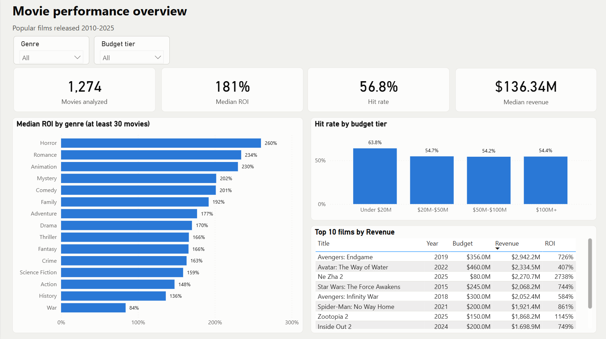
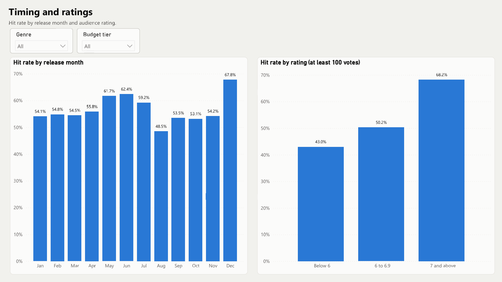
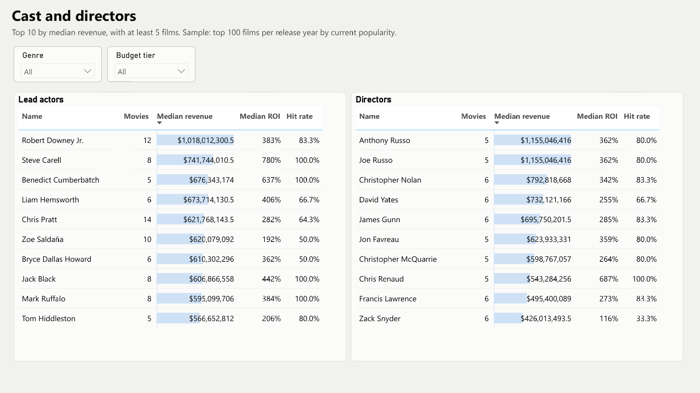

# Analysis Insights

**Question:** among popular movies, which budgets, genres and release months are linked to better returns?

**Data:** 1,274 movies released 2010–2025, as of November 2026. They come from the top 100 movies per release year by current TMDB popularity.

**Terms:**

- **ROI:** `(revenue - budget) / budget`
- **Hit:** a movie that earns at least 2.5x its budget (my own break-even assumption)

**Overall:** median ROI is 181%, the hit rate is 56.8%, and median revenue is \$136.3M.

## Dashboard

## Key insights

1. **Low-budget movies return the most, but carry more risk.** Movies under \$20M have the highest median ROI (328%) and hit rate (63.8%). However, 20.0% earn less than their budget, versus 11.0% at \$100M+.
2. **December is the best release month.** Its hit rate is 67.8%, while August has the lowest at 48.5%.
3. **Better-rated movies hit more often.** The hit rate is 68.2% for movies rated 7 and above, versus 43.0% for those rated below 6. Ratings only weakly track revenue, though, and they are only known after release.
4. **Horror has the highest ROI by genre.** Its median ROI is 260%. Horror movies under \$20M do especially well, with a 466% median ROI across 118 movies.
5. **The highest revenue does not mean the highest ROI.** *Avengers: Endgame* earned the most (\$2.94B, 726% ROI), while *Ne Zha 2* earned \$2.27B on an \$80M budget (2738% ROI).

## Recommendation

Focus on movies under \$20M, especially Horror, and consider December releases. Limit the amount spent on each movie, because low-budget results vary widely.

## Limitations

- **Popular movies only:** the data leaves out many movies that failed, so these numbers do not describe the whole market. For example, the hit rate is 67.3% for popularity ranks 1–50 but only 43.3% for ranks 51–100.
- **Missing financials:** movies with a budget or revenue under \$10,000 are excluded, which removes about 20% of the top-100 movies.
- **Costs not included:** revenue excludes marketing costs and the theaters' share, and is not adjusted for inflation.
- **Not cause and effect:** these patterns do not prove that a budget, genre or month causes success.